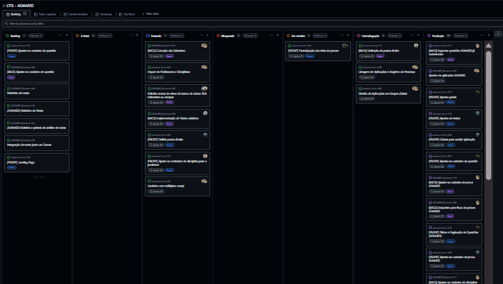

# Metodologia

 Neste projeto, optou-se pela aplicação da metodologia ágil Scrum, amplamente reconhecida por sua abordagem completa e eficiente para o gerenciamento e a distribuição de tarefas. Inspirado no rugby, o Scrum utiliza o conceito de "scrum" do esporte, em que os jogadores se reúnem rapidamente para alinhar estratégias. Seguindo essa analogia, a metodologia promove reuniões diárias curtas, conhecidas como daily scrums, que têm como objetivo:
 
- Atualizar o progresso do projeto.

- Identificar obstáculos e desafios.

- Planejar os próximos passos de forma colaborativa e transparente.

Essa abordagem garante maior organização, agilidade e adaptabilidade ao longo do desenvolvimento, permitindo que a equipe responda rapidamente a mudanças e entregue valor de forma incremental e consistente.

## Relação de Ambientes de Trabalho

| AMBIENTE | PLATAFORMA | LINK DE ACESSO | DESCRIÇÃO
|------------|---------------| ----------- |--------------- |
| Repositórios de Código | GitHub | [Repositorios do projeto](https://github.com/LTIS-PUC/Academic.Api) (https://github.com/LTIS-PUC/Identity.Api) (https://github.com/LTIS-PUC/adamed-front) (https://github.com/LTIS-PUC/Assessment.Api) | Hospedagem do código fonte do projeto, com versionamento e controle de branches. |
| Gestão de Tarefas | GitHub | [Quadro Kanban](https://github.com/orgs/ICEI-PUC-Minas-PMV-ADS/projects/1617/views/1) | Quadro Kanban para organização das tarefas do projeto, com colunas como "Backlog", "Ready", "In Progress", "In Review" e "Done". |
| Comunicação | Teams | Canal de Comunicação | Comunicação da equipe em canais específicos para discussões técnicas e gerais. |
| Design de Interfaces | Figma |[Projeto do Figma](https://www.figma.com/design/zqfFfslCIAkV8BSVPCRYXj/Projects?node-id=109-6&p=f&t=J4nHKkJgcAj4ooUT-0) | Prototipagem e design das interfaces do aplicativo móvel. |
| Hospedagem | --- | [Hospedagem do Projeto]() |Hospedagem do backend e frontend projeto, além do Banco de Dados. |
|Banco de Dados| PostgreSQL | [Banco de Dados]() | Banco de dados em tempo real e autenticação para aplicativos móveis. |

## Frameworks e Tecnologias para Desenvolvimento Mobile

| TECNOLOGIA/FERRAMENTA | DESCRIÇÃO
|------------|---------------|
| React Native | Framework mantido pelo Facebook, baseado em React e JavaScript. |
| Expo | Ferramenta que facilita o desenvolvimento e teste de aplicativos React Native. |

## Controle de Versão

A ferramenta de controle de versão adotada no projeto foi o
[Git](https://git-scm.com/).

## Gerenciamento de Projeto

### Divisão de Papéis

A equipe utiliza metodologias ágeis, tendo escolhido o Scrum como base para o processo de desenvolvimento. A organização da equipe é a seguinte:

| Nome  | Campus|
|------  |------|
| Prof. Fabiano Costa Teixeira  | PUC Poços de Caldas |
| Prof. Kleber Jacques Ferreira | PUC Contagem |
| Prof. Clóvis Lemos Tavares | PUC Betim |

### Scrum Master
Responsável: Otávio Canedo Neves (PUC Poços de Caldas).

Função: Garantir que o processo Scrum seja seguido, remover impedimentos e facilitar a comunicação e colaboração entre os membros da equipe.

| Membro | Cargo | Área | Campus |
|--- |--- |--- |--- |
| Otávio Canedo Neves | Analista Jr. / Scrum Master | Frontend | PUC Poços de Caldas |
| Carlos Henrique Santos da Silva | Auxiliar de TI | Frontend | PUC Contagem |
| André Gomes Cordeiro | Auxiliar de TI | Frontend | PUC Betim |
| Jonatas Nascimento de Jesus Souza | Analista Jr. | Backend | PUC Contagem |
| Filipe Eduardo da Silva | Analista Jr. | Backend | PUC Betim |
| Nicole Emanuele de Castro Silva | Auxiliar de TI | Backend | PUC Poços de Caldas |

Função: Desenvolver as funcionalidades do projeto, realizar testes e garantir a entrega de incrementos funcionais ao final de cada sprint.

### Processo

A fim de obter um processo mais organizado, optamos por utilizar o GitHub Projects para atribuir e acompanhar as tarefas dos membros do grupo, organizadas em:

- Backlog: Representa todas as tarefas que precisam ser realizadas ao decorrer do projeto;
- A fazer: Tarefas que foram filtradas do backlog do produto e iram ser desenvolvidas ao decorrer da sprint;
- Fazendo: Tarefas da coluna “backlog da sprint” que já foram iniciadas;
- Em revisão: Tarefas finalizadas, mas que ainda não foram revisadas.
- Homologação: Verificação com testes rigorosos, espelhando a produção, para validar funcionalidades.
- Produção: Ambiente real onde o software é disponibilizado aos usuários finais, garantindo estabilidade.

O quadro Kanban desenvolvido pelo grupo pode ser acessado clicando [aqui](https://github.com/orgs/LTIS-PUC/projects/1). Abaixo, é possível ver uma representação dele. 

 
### Ferramentas

As ferramentas utilizadas ao longo do projeto são:

- Editor de código;
- Ferramentas de comunicação;
- Ferramentas de design;
- Ferramentas de diagramação.

A escolha do editor de código foi motivada pelo impacto direto no controle de versionamento do projeto, garantindo rastreabilidade e organização no desenvolvimento. Além disso, o uso de ferramentas de comunicação, tanto para troca de mensagens instantâneas quanto para reuniões diárias, tornou-se essencial para promover a integração e o alinhamento entre os membros da equipe. Para a etapa de design, ferramentas específicas foram utilizadas na prototipação inicial da solução, permitindo a edição simultânea por um ou mais integrantes, o que favoreceu a colaboração e agilidade no processo criativo. Por fim, uma ferramenta de diagramação foi selecionada para mapear as necessidades do produto, proporcionando uma visão clara e estruturada do que está sendo desenvolvido. 

| CATEGORIA | FERRAMENTA | JUSTIFICATIVA | 
|------------|---------------| ----------- |
| Editor de Código | VS Code | Escolhido por ser um editor leve, altamente personalizável e com suporte a extensões que aumentam a produtividade, como integração com Git, depuração e linting. |
| Comunicação| Microsoft Teams | Facilidade de uso e colaboração em tempo real. |
| Controle de Versão | Git e Github | Padrão da indústria e facilidade de colaboração. |
| Wireframing | Figma | Colaboração em tempo real e recursos avançados de prototipagem. |
| Diagrama | Lucid app | Escolhido por ser uma ferramenta de diagramação colaborativa em tempo real, com uma interface intuitiva e suporte a diversos tipos de diagramas (fluxogramas, wireframes, UML, etc.). |
| Hospedagem |  |  |
