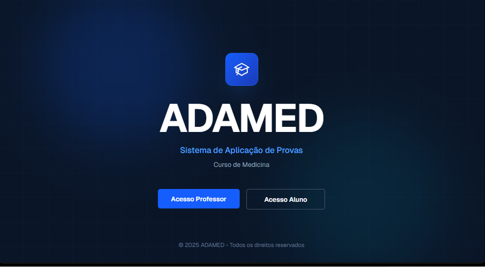

# Arquitetura da Solução

Pré-requisitos: [Documentação de contexto](https://github.com/LTIS-PUC/Docs/blob/main/ADAMED%20/01%20-%20Documenta%C3%A7%C3%A3o%20de%20contexto.md), [Requisitos do projeto](https://github.com/LTIS-PUC/Docs/blob/main/ADAMED%20/02%20-%20Requisitos%20do%20projeto.md),  [Metodologia](https://github.com/LTIS-PUC/Docs/blob/main/ADAMED%20/03%20-%20Metodologia.md)

Layout padrão da aplicação que será utilizado em todas as páginas com a definição de identidade visual, aspectos de responsividade e iconografia.

## Login 

### Home

### Cadastro de provas

